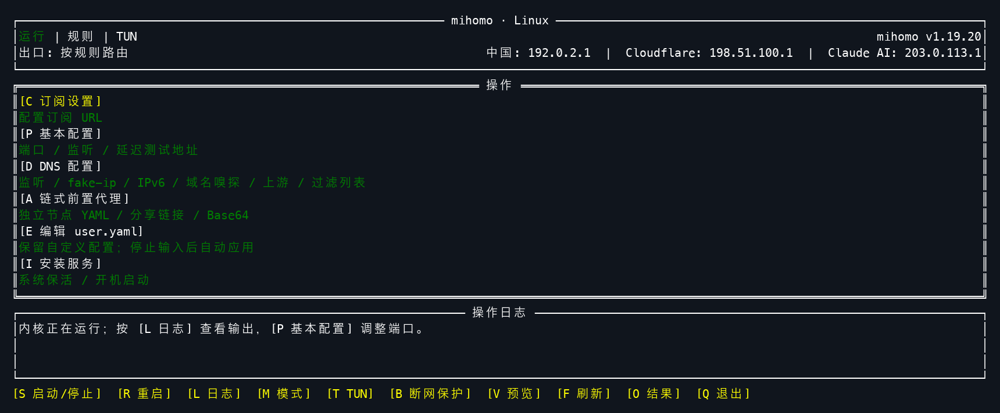
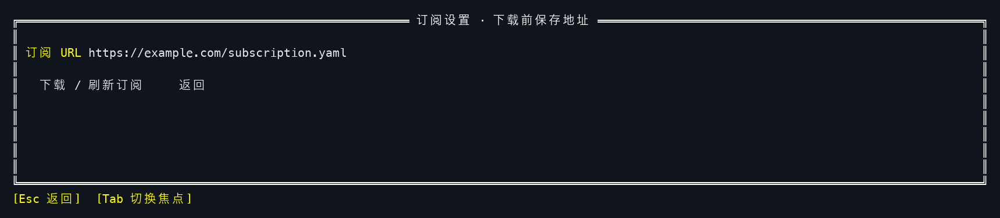
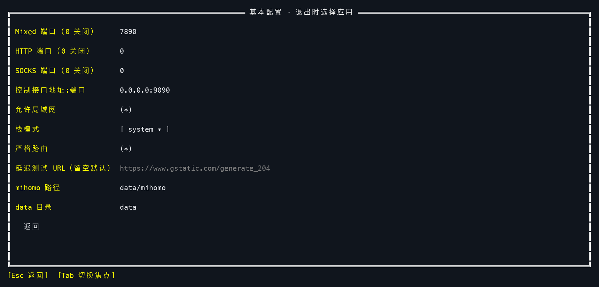
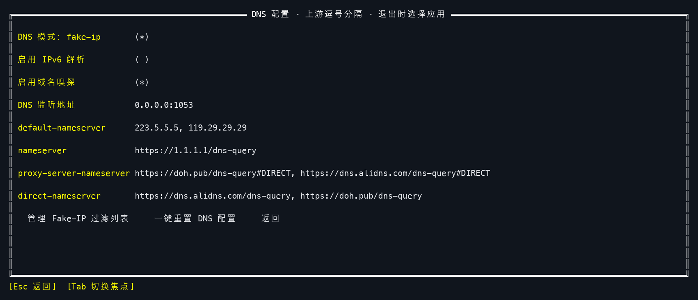
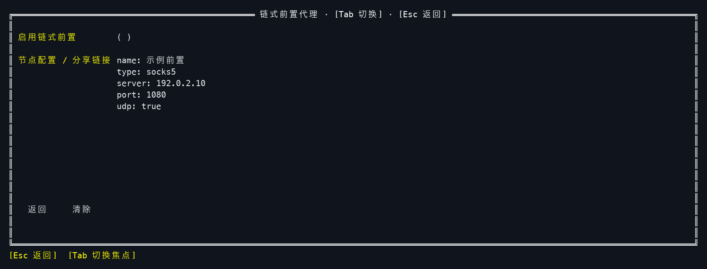
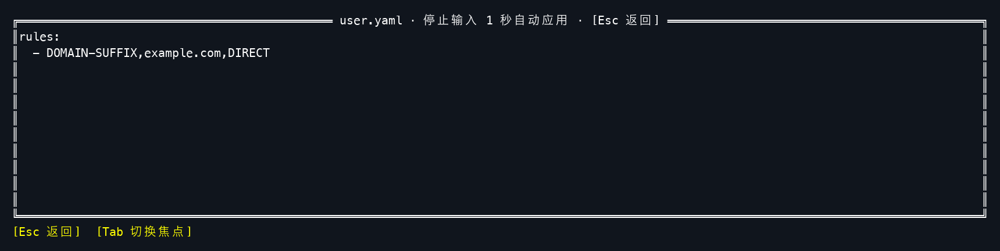

# tim

**在 Linux 终端里管理 mihomo。**

tim 是一个独立的终端管理工具，适合在 Linux 主机或 SSH 会话中使用。通过菜单完成订阅下载、代理启停、TUN 和 DNS 配置，也可以直接编辑 YAML；退出界面后，已启动的 mihomo 继续运行。



> 本文截图由当前 TUI 代码在模拟终端中绘制，订阅、节点和 IP 使用示例数据。实际颜色、字体及排版随终端设置和窗口大小变化。

[快速开始](#快速开始) · [配置页面](#配置页面) · [常用操作](#常用操作) · [配置文件](#配置文件) · [命令行](#命令行)

## 功能

- **订阅管理**：下载、刷新完整 mihomo YAML 订阅，保留订阅中的规则与策略组；也可直接粘贴一个或多个节点，自动生成订阅。
- **内核运行管理**：启动、停止、重启，查看状态、日志和完整操作结果。
- **代理与 TUN**：切换规则 / 全局模式，独立开关 TUN，配置端口、局域网访问和网络栈。
- **DNS 配置**：管理 fake-ip、IPv6 解析、域名嗅探、DNS 上游及 Fake-IP 过滤列表。
- **链式前置代理**：添加一个独立前置节点，支持节点 YAML、分享链接及 Base64 输入。
- **自定义配置**：内置 `user.yaml` 编辑器，停止输入后自动应用；支持预览最终配置。
- **状态与测速**：查看公网出口 IP，全局出口及链式前置支持点击测速。
- **内核下载与更新**：选择已有 mihomo，或下载官方稳定版；发现新版本后可在界面更新。
- **系统服务**：支持 systemd / OpenRC，安装后可管理开机启动与原生进程监督。
- **断网保护**：阻止普通应用在 TUN 中断后绕过代理直连公网，支持 nftables / iptables。

## 快速开始

### 1. 下载并运行

运行环境：**Linux 5.3+，amd64 或 arm64**。配置目录和数据目录需要当前用户可读写；界面可由普通用户启动，需要管理员权限的操作会请求 sudo 授权。

从 [Releases](https://github.com/cgistar/tim/releases) 下载对应架构的压缩包及 `SHA256SUMS`，在下载目录校验并解压。以下以 `v1.0.0`、amd64 为例，请替换为实际下载的版本与架构：

```bash
sha256sum --check --ignore-missing SHA256SUMS
tar -xzf tim-v1.0.0-linux-amd64.tar.gz
cd tim-v1.0.0-linux-amd64
./tim
```

发布包不包含 mihomo。首次打开界面会生成管理配置，进入界面不会自动下载或启动内核。

### 2. 添加订阅

按 **C** 打开「订阅设置」，选择订阅来源：

- **订阅 URL**：粘贴返回**完整 mihomo YAML** 的订阅地址。
- **手动节点**：粘贴多行 `vless://`、`vmess://`、`ss://`、`trojan://`、`hy2://` 等分享链接，或节点 YAML/JSON（`[{...}, {...}]`、`{...}`、`- {...}` 列表、`proxies:` 段），也可以是上述内容的整段 Base64。

然后选择「应用」。

未安装内核时也可以先下载订阅并生成配置。

### 3. 准备内核并启动

按 **S** 启动。内核缺失时，按提示输入已有 mihomo 的路径并选择「验证并使用」，或选择「下载」获取 GitHub 官方稳定版。验证成功后继续启动。

也可以提前将可执行的 mihomo 放在 tim 所在目录的 `data/mihomo`：

```bash
mkdir -p data
cp /path/to/mihomo data/mihomo
chmod +x data/mihomo
```

主界面显示「运行」后即可使用代理。默认 Mixed 端口为 **7890**，支持 HTTP 和 SOCKS；可在应用中设置代理地址，例如 `127.0.0.1:7890`。需要 TUN 时按 **T** 开启。**切换全局模式不会自动开启 TUN。**

按 **Q** 退出界面，mihomo 保持运行；要停止代理，请先按 **S**。

## 配置页面

主界面按对应字母打开页面，快捷键大小写均可。表单中用 **Tab / Shift+Tab** 或上下箭头切换字段，开关用 **空格 / Enter** 切换，也支持鼠标操作。

订阅、基本配置、DNS 和链式前置页面先编辑草稿；按 **Esc** 或选择「返回」时，有修改才询问是否应用。选择「确认」应用并保存，选择「取消」放弃草稿。配置应用时，运行中的内核通常会短暂重启；停止中的内核保持停止。

### C · 订阅设置



「订阅来源」二选一：订阅 URL 或手动节点。两边的内容都会保存，应用、`update-sub` 只使用当前来源。修改后选择「应用」，也可以返回并确认应用。「清除」会清空订阅 URL 和手动节点草稿，不会立即保存。

手动节点会生成固定模板的订阅：

| 内容 | 说明 |
|------|------|
| `auto-select` | url-test，包含全部节点，自动测速选择 |
| `all-nodes` | select，包含 `auto-select` 和全部节点，供面板或全局模式手动选择 |
| 规则 | localhost、`.local`、`.lan` 以及私有/保留 IP 段直连（不依赖 geo 数据库），最后 `MATCH,auto-select` |

节点名称重复或与 `DIRECT`、`GLOBAL`、`auto-select`、`all-nodes` 等冲突时自动追加 ` (2)` 等后缀。分享链接与 YAML/JSON 不能混合输入；解析错误只提示行号或序号，不回显节点内容。

来源会先保存，再执行下载或生成；无效的地址或节点不会保存。下载失败时保留旧订阅缓存；下载成功后的配置应用失败，也会保留新缓存。错误可在主界面操作日志中查看，按 **O** 展开完整结果。

### P · 基本配置



| 配置项 | 用法 |
| --- | --- |
| Mixed / HTTP / SOCKS 端口 | 默认仅开启 Mixed `7890`；设置为 `0` 关闭对应入口 |
| 控制接口地址:端口 | mihomo 控制 API 的监听地址，默认 `0.0.0.0:9090` |
| 允许局域网 | 默认开启；关闭后，自动配置的代理入口仅监听 `127.0.0.1` |
| 栈模式 / 严格路由 | TUN 网络栈与路由设置；支持 `mixed`、`system`、`gvisor` |
| 延迟测试 URL | 留空使用默认测试地址；影响主界面点击节点后的测速 |
| mihomo 路径 / data 目录 | 支持绝对路径，或相对于 `setting.yaml` 所在目录的路径 |

按 **Esc** 返回，确认应用。设置了 `DATA` 环境变量时，以环境变量指定的数据目录为准，页面也会显示提示。

### D · DNS 配置



可配置 fake-ip、IPv6 解析、域名嗅探和 DNS 监听地址。默认开启 fake-ip 和域名嗅探，关闭 IPv6 解析，DNS 监听 `0.0.0.0:1053`。

| 上游字段 | 用途 |
| --- | --- |
| `default-nameserver` | 解析 DNS 服务器域名的基础解析器 |
| `nameserver` | 常规域名解析上游 |
| `proxy-server-nameserver` | 代理节点域名解析上游 |
| `direct-nameserver` | 直连域名解析上游，可留空 |

同一字段填写多个上游时用**逗号分隔**。「管理 Fake-IP 过滤列表」中每行一项，**Ctrl+S** 确定列表、**Esc** 放弃列表修改；确定后还需返回 DNS 页并确认应用。

「一键重置 DNS 配置」将本页设置恢复为默认草稿，返回时确认才保存。若 `user.yaml` 覆盖了这些字段，页面会提示配置来源。

### A · 链式前置代理



粘贴**一个独立节点**，开启「启用链式前置」，返回并确认应用。支持单节点 YAML、常见协议分享链接，以及单节点内容的 Base64。

连接路径为：**本机 → 前置节点 → 原代理出口 → 目标网站**。规则和全局模式均可使用，TUN 开关独立。

图中的 SOCKS5 地址仅作格式示例，使用时请替换为自己的节点。「清除」会清空输入并关闭开关，返回确认后生效。应用后可在主界面查看链式前置状态；显示「未生效」时，请查看原因。

### E · 编辑 user.yaml



用于添加自定义规则或覆盖自动配置。**停止输入约 1 秒会自动校验并应用**；按 **Esc / Ctrl+S** 应用并返回。YAML 有误时保留编辑内容并显示错误。

普通配置的合并顺序为：**订阅 → tim 管理配置 → user.yaml**。映射递归覆盖，普通列表整体替换；自定义 `rules` 去重后前置到订阅规则。

`mode` 和整个 `tun` 段由界面管理，`user.yaml` 中的对应内容不生效；启用链式前置时，其链路字段也由 tim 管理。按 **V** 可预览最终配置，预览包含凭据，请勿直接分享。

## 常用操作

| 快捷键 | 操作 |
| --- | --- |
| **S / R** | 启动或停止 / 重启；停止时按 R 会启动 |
| **M / T** | 切换规则与全局模式 / 开关 TUN |
| **G** | 全局模式运行中打开 GLOBAL 出口列表，↑↓ 选择、Enter 切换 |
| **L** | 查看内核日志；↑、PageUp、Home 暂停跟随，End 回到最新 |
| **B** | 开启或关闭断网保护 |
| **I** | 安装或卸载系统服务 |
| **K** | 内核不可用、右上角显示「下载」时打开内核设置 |
| **U** | 提示有新版本时更新 mihomo 内核 |
| **V / F / O** | 预览最终配置 / 刷新状态 / 展开操作结果 |
| **Q** | 退出界面，保留正在运行的 mihomo |
| **Ctrl+C** | 操作进行中请求取消；空闲时退出界面 |

主界面展示运行状态、模式、TUN、内核版本和公网 IP。全局模式的出口及已启用的链式前置后有测速入口，点击 **⚡** 测试延迟，点击数字可重新测试，数值单位为毫秒。规则模式显示「按规则路由」。全局模式下按 **G** 可从内核 GLOBAL 候选（DIRECT、策略组、节点）中选择出口，当前选择以 ● 标记，策略组附带其当前节点；切换通过 mihomo 控制 API 完成并回读确认，选择由内核记忆。

**系统服务**：先停止内核，再按 **I** 安装。支持 systemd 和 OpenRC；安装完成仍保持停止，按 **S** 启动后启用开机启动。通过 tim 停止时也会取消开机启动；卸载会停止服务，保留配置与数据。OpenRC 快速退出后的持续重试存在[已知限制](docs/advanced.md#系统启动服务与原生监督)。

**断网保护**：按 **B** 开启，需要 sudo/root 和可用的 nftables 或 iptables。它会阻止普通应用绕过 TUN 直连公网，停止 mihomo、关闭 TUN 或退出 tim 后仍保留。关闭保护需要明确确认。公网 SSH 连接也可能受影响，请在本地控制台操作；跨重启是否保留取决于系统防火墙规则加载方式。详见[断网保护说明](docs/advanced.md#断网保护)。

## 配置文件

`setting.yaml` 固定在 **tim 实际可执行文件所在目录**；从其他目录或软链接启动仍使用同一位置。默认数据目录为旁边的 `data/`。

```text
tim/
├── tim                 # 可执行文件
├── setting.yaml        # 界面管理的设置
└── data/
    ├── mihomo          # 默认内核路径
    ├── user.yaml       # 自定义配置，可不存在
    ├── subscription.yaml # 最近下载成功或由手动节点生成的订阅
    ├── config.yaml     # 生成的运行配置
    ├── home/           # 内核缓存与 provider 文件
    ├── kernels/        # 下载、更新的内核
    ├── mihomo.log      # 内核日志
    └── error.log       # 操作错误详情
```

可通过 **P · 基本配置** 修改内核路径和数据目录，也可以临时覆盖数据目录：

```bash
DATA=/absolute/path/to/data ./tim
```

数据目录优先级为 **`DATA` → `setting.yaml` 的 `data-dir`**，相对路径以配置目录为基准。已有配置的内核路径单独由 `mihomo-path` 决定，不随 `DATA` 自动改变。切换数据目录不会自动搬移历史日志和缓存。

启动和重启使用已生成的 `config.yaml`。需要修改配置时，请在对应页面应用，避免直接编辑生成文件。操作失败后先查看 **O · 结果** 或 `error.log`；已经保存的订阅和配置不会因后续启动失败自动回滚。

## 命令行

无参数运行 `./tim` 打开界面，也可通过子命令管理同一套配置。先打开一次界面生成 `setting.yaml`；需要管理员权限的 CLI 操作用 `sudo` 执行，使用了 `DATA` 时需保持同一数据目录。

```bash
./tim status                # 查看状态
sudo ./tim start            # 启动已有运行配置
sudo ./tim stop             # 停止；已安装服务时同时取消开机启动
sudo ./tim restart          # 重启
sudo ./tim update-sub       # 更新订阅并应用，停止状态保持停止
sudo ./tim update-sub --hot # 运行中热更新，不改变 PID，有配置变更限制
sudo ./tim install          # 安装系统服务，要求内核已停止
sudo ./tim uninstall        # 确认后停止并卸载服务
sudo ./tim guard status     # 查看断网保护状态
sudo ./tim guard on         # 开启保护
sudo ./tim guard off        # 确认后关闭保护，恢复直连
```

## 更多说明

- [配置与运行参考](docs/advanced.md)：配置合并、链式前置格式、断网保护、服务行为及失败处理。
- [开发、测试与发布](docs/development.md)：从源码构建、Linux 集成验证和 GitHub Actions 发布流程。
